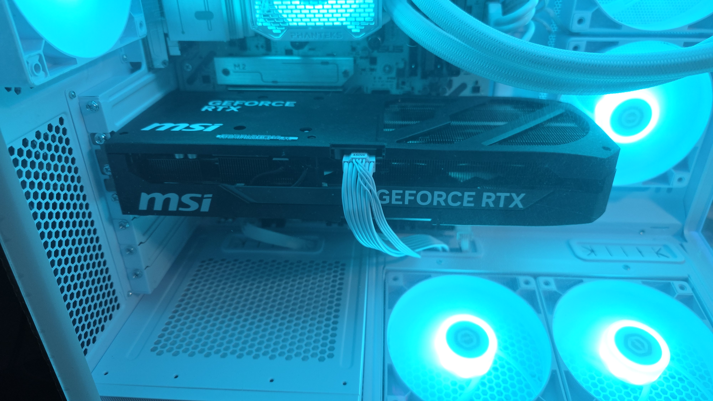

# GPU (Graphics Card)

The graphics card (GPU) renders every frame, shadow, and texture on screen. Upgrading your GPU is usually the single most effective way to boost frame rates and visual settings.

## Resolution & VRAM Targets
Your monitor's resolution dictates how much Video RAM (VRAM) you need to prevent texture stutters. **1080p** runs well on **8GB to 12GB of VRAM**, though your [[cpu-motherboard-pairing|CPU and motherboard]] also work hard at this resolution. **1440p** is the modern sweet spot, needing **12GB to 16GB of VRAM** for sharp visuals and high frame rates. **4K gaming** demands **16GB or more** so high-resolution textures never spill into slower system memory.

Upscaling features like **NVIDIA DLSS** and **AMD FSR** render games at a lower internal resolution and sharpen them back up, giving you major frame rate gains with minimal visual loss.

## Physical Clearance & Support
Modern GPUs often exceed 330mm in length and take up **2.5 to 3.5 expansion slots** in thickness. Always check your case's maximum GPU clearance, especially if you mount a front radiator for [[pc-cooling-airflow|cooling]]. Because heavy coolers can droop and stress the motherboard's PCIe slot, place an adjustable anti-sag stand under the outer corner.

### Display Outputs & Cables
Before buying, check that the card matches your monitor connections. If able, use **DisplayPort (1.4 or 2.1)** over HDMI for PC gaming monitors to reliably run high refresh rates and adaptive sync (G-Sync or FreeSync). Most current cards include three DisplayPort outputs and one HDMI 2.1 port. Stick to VESA-certified cables under 6 feet long to prevent signal loss.