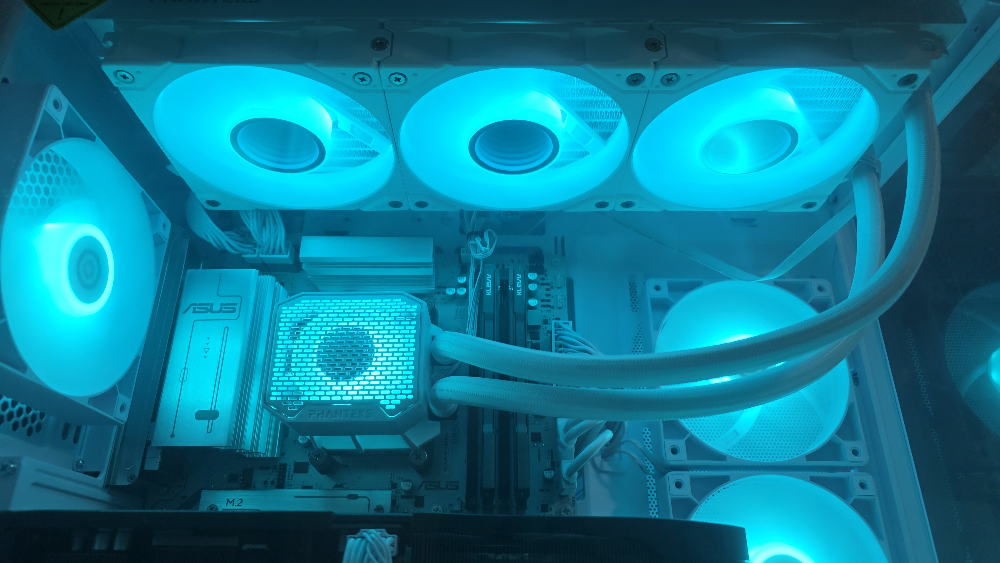
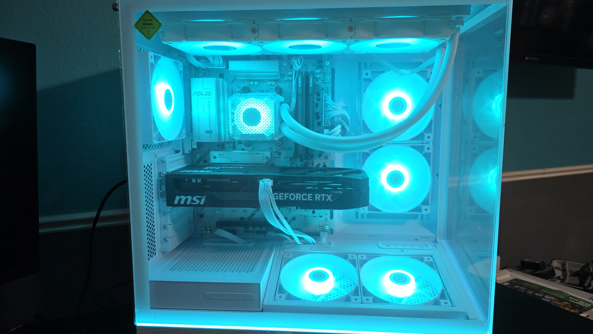

# Cooling

Effective cooling prevents your hardware from thermal throttling (slowing down to avoid overheating) while keeping fan noise low during gameplay.

## Air vs. AIO Liquid Cooling
**Dual-tower air coolers** use copper heat pipes and fin stacks to pull heat from the [[cpu-motherboard-pairing|CPU & Motherboard]]. They are affordable, nearly impossible to break, and easily handle most gaming chips. **AIO (All-In-One) liquid coolers** pump fluid to a **240mm or 360mm radiator**, offering quiet sustained cooling, unobstructed RAM clearance, and a cleaner look. Always verify case height limits for air coolers or radiator mounting space for AIOs before buying.

## Case Airflow & Air Pressure
Since warm air rises, pull cool air in through the **front and bottom** (intake) and push warm air out through the **top and rear** (exhaust). Keeping your interior wiring tidy with good [[psu-cable-management|cable management]] also ensures intake air flows straight across your components unobstructed.

Using slightly more intake fans than exhaust fans creates **positive air pressure**:
* **Dust Control:** Positive pressure pushes air out of tiny case gaps, preventing dust from sneaking in through unfiltered vents.
* **Fan Orientation:** Check the airflow arrows stamped on the fan frame. Air normally flows toward the side with the plastic support struts unless you buy reverse-blade intake fans.

### Custom Fan Curves
Default motherboard fan profiles often ramp up noisily during simple tasks. Set a custom **PWM fan curve** in your BIOS to keep fans around 30%–40% speed under 50°C, ramping up smoothly only when gaming temps cross 70°C.

## Thermal Paste & Phase-Change Pads
Thermal paste is a must for any CPU build because it fills in microscopic gaps between the processor and cooler to transfer heat properly, preventing overheating. For a zero-maintenance option, **phase-change thermal pads** (like PTM7950) never dry out, apply cleanly, and transfer heat better as they warm up, though they do have a break-in period of higher running temps before they manage the heat consistently.
