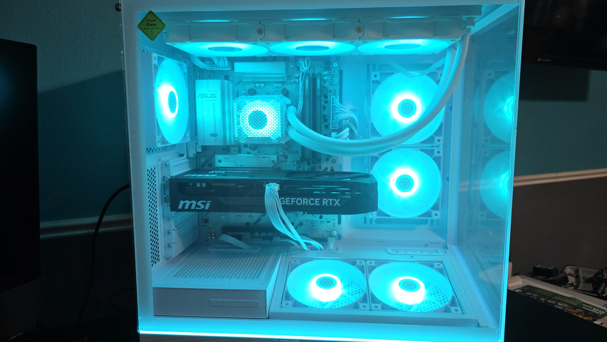

# PSU & Cable Management

Your Power Supply Unit (PSU) turns wall power into steady electricity for every part in your rig. Never cheap out on a PSU, since a bad unit can take expensive hardware down with it.

## Wattage Headroom & Efficiency
Add up your system's total wattage and multiply by **1.25 or 1.3** to leave 20%–30% extra room. Modern [[gpu-guide|GPUs]] have quick power spikes that can shut down a PSU if it is running too close to its limit. Look for an **80 Plus Gold** rating from a trusted brand with a 7- to 10-year warranty.

## ATX 3.1 & Modular Cables
Pick an **ATX 3.0 or ATX 3.1** PSU so you get a native **12V-2x6 (16-pin)** cable that plugs straight into newer NVIDIA GPUs without clunky adapters. 

> **Critical Safety Rule:** Never reuse modular cables from an old PSU on a new PSU, even if both are from the same brand. Internal wiring layouts change between models and can instantly fry your motherboard or drives.

When shopping, stick with a **fully modular** PSU if your budget allows. Unlike non-modular units where every cord is permanently attached, fully modular designs let you leave unused cords in the box so you have way less clutter to hide.

## Planning for Clean Cable Management
Good cable management is mostly decided before you even start building. Keeping wires neat improves [[pc-cooling-airflow|case airflow]], makes dust cleaning easier, and keeps glass side panels looking clean.

* **Check Case Space:** Look for cases with at least **20mm to 25mm of space** behind the motherboard tray and built-in rubber grommets so thick power cords pass through cleanly.
* **Custom Sleeved Cables:** Standard PSU cables can be stiff and bulky. Braided extensions or full custom cable kits bend much easier around tight corners and match your build's color theme.
* **Velcro Over Zip Ties:** Plan to bundle cords with reusable **Velcro straps** instead of plastic zip ties so swapping out a part later doesn't require snipping wires in tight spaces.

